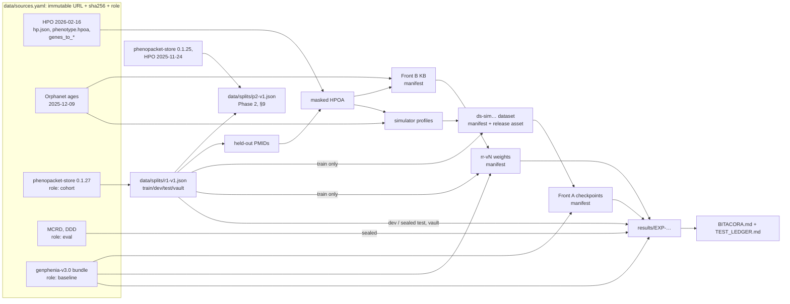

# Data lineage

Every number we report must trace back, with no gaps, to:
- pinned external bytes;
- a code SHA;
- a set of parameters.

This document says how that works and what we still cannot trace.

## 1. The graph

## 2. Rules

1. **Nothing enters without a pin.** Every external file is listed in
   `data/sources.yaml` with an immutable URL and its sha256. For a source
   whose upstream URL is mutable (Orphadata), we publish a snapshot as a
   release asset of this repo and pin that.
2. **Raw bytes are never edited.** `data/raw/` is populated only by
   `dxt sources fetch`, which verifies the sha256 whatever the origin (a local
   copy or the URL). GitHub release URLs are downloaded with `gh`, so private
   release assets (the Orphanet snapshot, the v3.0 bundle) work too. Code gets paths only through `registry.open_source(name,
   purpose)`, which also checks the role **[code]**.
3. **Roles limit flow [code].**
   - `knowledge` may feed anything.
   - `eval` may only be evaluated on.
   - `baseline` may be evaluated on or warm-started from, but never trained on
     as data.
   - `cohort` is reachable only through a frozen split, whose parts have their
     own purposes (`EVAL_PROTOCOL.md` §1).
4. **Every derived artifact has a manifest.** Datasets, KBs, embeddings,
   checkpoints and re-ranker weights each get
   `data/manifests/<artifact-id>.json`, recording:
   - the kind;
   - the creation time;
   - the code (repo, SHA, dirty flag);
   - the inputs (`id` + sha256: sources, splits, other artifacts, the
     held-out PMID list);
   - the params and their hash;
   - every output file with sha256 and size.

   `build_manifest` refuses a dirty working tree **[code]**.
5. **Artifact ids are immutable [code].** A changed artifact gets a new id
   (e.g. `ds-sim0.2.0-hpo20260216-n200-s42` → `…-s43`, or `sim0.2.1`).
   `write_manifest` refuses to overwrite.
6. **Storage.**
   - Manifests, splits, configs and results tables are committed to git.
   - Large binaries (datasets, checkpoints, KBs) are uploaded as **GitHub
     release assets** of this repo, one release per artifact id; the URL goes
     in the manifest notes (ADR-0005).
   - Local copies can be deleted and re-fetched; their hashes are re-checked.
7. **Cross-repo inputs are pinned by SHA.** Simulator output used here records
   the `rare-disease-simulator` commit and its config hash. Code copied from
   upstream or teammates carries a header naming the source repo, path and
   commit.
8. **Verify before logging.** Before an experiment is recorded, run
   `dxt lineage verify`. It re-hashes sources, re-checks split hashes, and
   re-hashes every manifest's outputs that are present locally.

## 3. Adding a source

1. Get an immutable URL: a release asset, a commit-pinned raw URL, or our own
   snapshot release.
2. Compute its sha256.
3. Choose its role, and justify it in the `notes` field.
4. Add the entry to `data/sources.yaml`, with `local_candidates` if a verified
   copy exists on this machine.
5. Run `dxt sources fetch <name>` and `dxt sources verify`.
6. Log it in `BITACORA.md`. If it is a patient source, it must get a frozen
   split before anyone looks at model outputs on it.

## 4. HPO versions in play

| Release | Where | Used for |
|---|---|---|
| 2026-02-16 | `hpo_*` sources | Annotations, KB, simulator profiles, graph ontology for new models |
| 2025-11-24 | inside the v3.0 bundle (`hp.json`) | v3.0's own graphs (parity) |
| 2025-03-17 | v3.0 embeddings (BioBERT-NLI memmap) | Node features; missing terms are zero vectors |
| 2025-11-24 | phenopacket-store 0.1.27 metadata | The cohort's annotations |
| 2025-11-24 | `hpo_annotations_2025_11_24` (`phenotype.hpoa`) | Only its `reference` column: marks publications E0 could have seen (post-E0, §9) |
| 2026-01-08 | diagnostic.ar-api gateway `hp.obo` | Production extraction (outside this repo) |

Every evaluation reports the share of case terms that are unknown to the
model's ontology or zero-embedded.

## 5. Known gaps (declared, not fixable)

- **v3.0 training data is unavailable.** Here is what we know about it:
  - it was simulated from `genes_to_phenotype` (HPO ~2025-11);
  - it had 5,000 patients per gene, with `include_reverse_edges=False`;
  - it was built on the original author's machine.

  We cannot mask R1 publications out of it, so E0 on R1 is optimistic
  (`EVAL_PROTOCOL.md` §4.5).
- **The original sources of MCRD and DDD** are not documented in GraPhens;
  they must be cited in the informe once found. GraPhens also fine-tuned an
  experimental model on DDD (`validation_arena/finetune_ddd_model.py`). There
  is no evidence that v3.0 did.
- **DDD looks annotation-derived.** 97.1% of its cases carry an
  inheritance-mode term, and the median case's terms are all verbatim
  annotations of the gene (EXP-000 Addendum 1). It overstates real-patient
  performance of any model trained on HPO annotations.
- **R1 terms are often verbatim HPO annotations** (78% of dev cases are fully
  annotated, vs 3.5% for MCRD). This quantifies the E0-optimism caveat above.
- **ClinVar and ClinGen evidence** (gene profiles, ADR-0008) cites
  publications that may include R1 papers. These sources contribute no
  phenotype terms; they only shift a disease's weight within its gene. Not
  masked; declared.
- **Bitgenia cases** (`GraPhens/validation_arena/Casos_Bitgenia*.json`) are
  not registered. Their origin and consent status are unknown, so they are
  not used (G10).

## 6. Record of lineage events

| Date | Event | Details |
|---|---|---|
| 2026-10-08 | Artifact `ft-kb-all-v2` built (not published) | ft-v1.1 knowledge from `1bb3926` (`ft-kb/2`), same sources, mask and overrides as `ft-kb-all-v1`; XLR-only now needs the explicit HP:0001419 (125 genes, was 164; 39 generic-X-linked genes dropped), no XLD flag; otherwise identical to v1; `ft-kb.json.gz` sha256 `18cf37f1…` (§11) |
| 2026-10-08 | EXP-P-003 addendum runs and bundles (ft-v1.1) | 27 `ft-run` manifests `results-EXP-P-003-ft-v1.1-*` (8 configurations × 3 seeds and the c1 ablation × 3); bundles `ft-v1.1-c1-lin-all-ens` (sha256 `89e3ea09…`) and `ft-v1.1-c1-lin-all-nosexage-ens`; `results-EXP-P-003-report-ft-v1.1`; `results-EXP-P-003-ft-v1.1-c1-lin-all-ens-train-harmed` (§11) |
| 2026-10-08 | Artifact `ft-kb-all-v1` built (not published) | ft-v1 knowledge from `c70070e`, every `r1-v1` PMID masked: 75 male- and 17 female-limited genes (49 overrides), 2,786 strict onsets, 164 XLR-only, 23 XLD-only, 659 negatable; `ft-kb.json.gz` sha256 `d3996021…` (§11) |
| 2026-10-08 | EXP-P-003 runs and bundles | 27 `ft-run` manifests (8 configurations × 3 seeds and the c1 ablation × 3); bundles `ft-v1-c1-lin-all-ens` (sha256 `5a26e537…`) and `ft-v1-c1-lin-all-nosexage-ens` (§11) |
| 2026-10-07 | Split `p2-v1` frozen | content sha256 `b1ccdada1b353f200ee0331293553db23dd5cf551d59537e1aade03577732851`, derived from `r1-v1` (§9) |
| 2026-10-07 | Sources added | `phenopacket_store_0_1_25` and `hpo_annotations_2025_11_24` (ADR-0017), used only to mark post-E0 publications |
| 2026-10-07 | Artifact `safe-kb-v1a` built (not published) | safe-v1 knowledge, uncurated, from `c264596`: 100 male-limited and 41 female-limited genes, 2,895 genes with a strict earliest onset (615 at ≥ 1 year), 679 negatable genes; bundle and stats committed in `data/safe/safe-kb-v1a/` (§10) |
| 2026-09-30 | Source added | `orphanet_phenotypes`: Orphadata product 4 (2026-06-23), release `data-snapshot-2026-09-30-product4` |
| 2026-09-30 | Simulator v0.4 artifacts built and published | `hpoa-recount-v1`, `cardinal-v1`, `report-model-v1` (superseded by `report-model-v2`, same fit in the simulator's format), `genes-v2`, `simcal-v04-v1`, `literature-panel-v1` (§7) |
| 2026-09-30 | Realism baselines | `dxt sim realism` on UP (`graphens_sim_20251202`) and V03 (`ds-sim0.3.1-A-n100-s1001`), plus a smoke run on the ANALYSIS-001 10-gene sample; ledgered as baselines |
| 2026-09-28 | Sources registered | 9 sources; all verified from local copies (`dxt sources fetch --no-download`) |
| 2026-09-28 | Split `r1-v1` frozen | content sha256 `b007aa17741c2309a2fce9e36aaa77608d3d2b1311630e96c77be9d39e462ccf`, before any model was run on the cohort |
| 2026-09-29 | Sources added | Orphanet 2026-06-23 alignments + ages (release `data-snapshot-2026-09-29`); HGNC, Orphanet genes + prevalence, ClinGen (release `data-snapshot-2026-09-29-genes`); MONDO v2026-09-01 and ClinVar 2026-09 by immutable URL |
| 2026-09-29 | Artifact `kb-v3` built and published | Front B KB, schema 2: ADR-0007 frequencies (phenotypes at frequency 1.0: 32,615 in kb-v1 → 649), Orphanet 2026-06 onset + exact alignments (onset for 9,487 diseases; v3.0 genes with onset 4,286 → 4,529), gene → disease weights from `genes-v1` |
| 2026-09-29 | **Artifact `kb-v2`: VOID. Do not use** | Built by mistake: a failed CLI edit left the schema-1 command path, so it used the 2025-12 Orphanet ages with no alignments and no gene weights (built from `cbd34fa`, before the CLI was fixed). Its id is kept burnt, not deleted or reused. The intended KB is `kb-v3`. Build commands now refuse existing ids before doing any work (`ensure_new`) |
| 2026-09-29 | Artifact `genes-v1` built and published | Gene profiles (ADR-0008): 5,568 genes, 13,960 disease entities (11,125 simulable); 5,050 of v3.0's 5,228 genes are simulable. Weights calibrated on R1-train only |
| 2026-09-29 | Artifact `kb-v1` built and published | Front B KB from commit `d3a2e3e`, release `kb-v1`: 12,802 diseases, 5,148 genes, 249,434 phenotype annotations; 15,412 held-out-PMID rows masked. Masking audit: R1-dev cases fully covered by KB annotations fell from 78.1% (unmasked) to 16.1% |
| 2026-09-29 | Source added | `graphens_sim_20251202` (S2, role eval) from GraPhens@7d861ff; MCRD and DDD marked `sealed` |
| 2026-09-29 | E0 measured (EXP-000) | Production parity: bit-identical to the vendored engine on 300 cases. Sealed reads of r1-v1/test, MCRD and DDD ledgered |
| 2026-09-28 | Leakage measured | 15,412 of 282,723 HPOA rows (5.45%, 457 diseases) cite R1 held-out PMIDs; MCRD/DDD have 0 exact (gene, present) overlaps with R1 |

## 7. Simulator v0.4 artifacts (ADR-0011, ADR-0012)

All are fitted or counted on R1-train only. Each has a manifest in
`data/manifests/` and, when large, a release of the same tag.

| Artifact | What | File the simulator reads |
|---|---|---|
| `hpoa-recount-v1` | `phenotype.hpoa` with rows citing held-out PMIDs recounted as `n/m` over R1-train phenopackets (`reference R1-TRAIN:r1-v1`), dropped when `m < 3` | `phenotype.hpoa` (`build-profiles --hpoa`); also `feature-onsets.tsv` (per-feature onset quartiles, ≥ 3 patients) and `data/hpoa-recount/hpoa-recount-v1.stats.json` (kept/recounted/dropped per disease) |
| `cardinal-v1` | Hallmark features: Orphadata product 4 diagnostic criteria and pathognomonic signs (new source `orphanet_phenotypes`), plus count proxies (`m ≥ 10`, `n/m ≥ 0.8`) | `data/cardinal/cardinal-v1.tsv` (`disease_id, hpo_id, kind, source`) |
| `report-model-v1` | Reporting model, first layout (superseded, kept for lineage) | — |
| `report-model-v2` | The same fit, in the simulator's `report-model` v1 format | `report-model.json` (release `report-model-v2`) |
| `genes-v2` | Gene profiles with R1-train patient counts in the weight and zero weight for somatic-only and unsupported links; profiles from `hpoa-recount-v1` | `genes.json.gz` (release `genes-v2`) |
| `simcal-v04-v1` | `frequency.shrinkage_mean`: median pooled count-based frequency of `hpoa-recount-v1` | `data/calib/simcal-v04-v1.json` |
| `literature-panel-v1` | Literature prevalence of 37 features of 8 diseases, with citations | `data/realism/literature-panel-v1.tsv` (read by `dxt sim realism`) |

**Realism reports** (`dxt sim realism`, `dxt sim report-model-check`) go to
`results/realism/`, each with a manifest `realism-<label>`. Every run reads
R1-dev and appends a row to `results/realism/LEDGER.md`; baselines (UP,
V03) and checks do not count against the 3-candidate budget, and the
command refuses a fourth candidate version. `dxt sim gate` writes the G2
comparison table (`gate-<name>.json`, `.md`).

## 8. Literature-enriched profiles (ADR-0013 amendment 2)

`dxt lit build --version N` turns `data/lit-extract/rows/*.tsv` into three
artifacts. It reads every C/P shard of `shards.tsv` and every Q shard of
`shards-papers-v2.tsv` that has a passing report, re-validates each one in
memory, and refuses any shard that fails. Code:
`knowledge/lit_build.py`; tests: `tests/test_lit_build.py`, one or more per
rule.

| Artifact | What | File the simulator reads |
|---|---|---|
| `hpoa-lit-vN` | Feature rows as HPOA phenotype rows (aspect P, evidence `PCS`, biocuration `diagnostic.ar-training:lit-extract`, reference = `source_id`) | `phenotype.hpoa`, plus `data/lit-build/hpoa-lit-vN.report.json` |
| `hpoa-enriched-vN` | `hpoa-recount-v1` with `hpoa-lit-vN` appended; a `#derived` header line records both sha256 | `phenotype.hpoa` (`build-profiles --hpoa`) |
| `presentation-ages-vN` | One age range per disease from `AGE_PRESENTATION` rows | `presentation-ages.tsv` (`simulate --presentation-ages`, sim ≥ 0.5.1) |
| `onset-ages-vN` | One onset-age range per disease from `AGE_ONSET` rows, selected like presentation ages (ADR-0013 am. 4) | `onset-ages.tsv` (`simulate --onset-ages`, sim ≥ 0.5.4) |

`--dry-run --out-dir … --report …` writes the files and the report with no
artifact id and no manifest. The latest dry run (45 shards, amendment 3) is
`results/analyses/LIT-INTEGRATION-dryrun.json`.

**Where amendment 2 is silent**, the build does the following, as ruled
in ADR-0013 amendment 3. Each choice is counted in the report.
- **Rule 5 citations.** Rows carry a `source_id`, not a PMID list. A paper
  is cited by its PMID. A chapter is cited by its NBK id, its own PMID (from
  the GeneReviews index `GRtitle_shortname_NBKid.txt`), a Bookshelf URL
  `…/books/NBK…/`, or `br.fcgi?book=gene&part=<shortname>`; HPOA writes the
  last two forms. Terms are compared after resolving alternative ids.
- **Rule 2 skip.** A "unit-specific row" is any non-`pooled_group` row from
  the same source, for the same term, on the same disease id.
- **Zeros.**
  - A `pooled_group` row with prevalence 0 becomes NOT on every listed
    disease. A `0%` row would be a positive annotation.
  - Every validated prevalence-0 row without both counts is read as an
    explicit absence (guide v4 §6a). That includes rows with only
    `n_assessed`. Shards extracted before v4 are not told apart.
- **Rule 6, counts** (amendment 3). From one source, only the count row
  with the largest denominator is kept ("distinct sources only"). If two
  rows share that denominator and their n/m differ by more than 0.20, the
  term is dropped from that source (`ambiguous_populations`). The pooled
  row lists every source in `reference`, `;`-separated.
- **Rule 6, percentages** (amendment 3).
  - Preference order: both sexes, then the largest stated `n_assessed`
    (0 when not stated), then unit before `pooled` before `pooled_group`,
    then source id and file order.
  - The guard: when one source's rows are still tied after sex and n, and
    their prevalences differ by more than 0.20, the term is dropped from
    that source (`ambiguous_populations`).
  - A percentage is still written beside literature counts. The simulator
    ignores it, by its precedence.
- **Sex.** The `sex` column is `MALE`/`FEMALE`, as HPOA writes it. A pooled
  row keeps it only when every pooled row agrees, as the simulator does.
- **Rule 7.**
  - A missing low end is 0 ("before X", or a range that starts prenatally).
  - A missing high end gives no range, so the row is not used.
  - A `pooled_group` age row applies to each listed disease that has no
    other `AGE_PRESENTATION` row from the same source.
  - After population size, a row for both sexes beats a sex-restricted
    row.
- **Onset column** stays empty: no feature row carries a feature onset age.

## 9. Phase 2 splits (ADR-0017)

| Split | Inputs | Parts |
|---|---|---|
| `p2-v1` (frozen 2026-10-07, `b1ccdada…`) | `split:r1-v1` (`b007aa17…`), `phenopacket_store_0_1_25`, `hpo_annotations_2025_11_24`; patients from `phenopacket_store` (0.1.27) | train 4,103 / dev 1,883 / test 3,587 / vault 732 patients |
| `p2-fresh-v1` (to be frozen 2026-10-20) | a snapshot of phenopacket-store `main`, `phenopacket_store` (0.1.27), `phenopacket_store_0_1_25`, `hpo_annotations_2025_11_24`, `hpo_annotations` (2026-02-16) | vault only |

- **`p2-v1`** keeps `r1-v1` train and dev and re-partitions the `r1-v1` test and vault publication groups by post-E0
  status. The file records group counts by status for each `r1-v1` part (`group_status_by_parent_part`). Its
  held-out PMIDs equal `r1-v1`'s (`tests/test_committed_splits.py`), so `r1-v1.heldout-pmids.txt` stays the mask.
- **0.1.25 and HPO 2025-11-24 are read for PMIDs only:** the `id` and `metaData.externalReferences` of each 0.1.25
  phenopacket, and the `reference` column of `phenotype.hpoa`.
- **The fresh snapshot** is a GitHub tarball of one commit. Only `notebooks/<cohort>/phenopackets/*.json` members are
  read, in path order; a repeated phenopacket id keeps its first file.

### Pinning the snapshot and freezing `p2-fresh-v1`
1. `dxt sources snapshot-github --name phenopacket_store_main_2026_10_20 --before 2026-10-20T00:00:00Z`
   - It resolves the last commit on `main` committed strictly before the timestamp (GitHub commits API, committer
     date).
   - It downloads `https://github.com/monarch-initiative/phenopacket-store/archive/<sha>.tar.gz` into
     `data/raw/<name>/phenopacket-store-<sha>.tar.gz`.
   - It prints the `data/sources.yaml` entry: role `cohort`, version `main@<sha7>`, the archive URL, the commit page
     as `upstream_url`, the sha256, license and notes.
2. Paste the entry into `data/sources.yaml`, run `dxt sources verify`, and commit.
3. From that clean tree, run `dxt split freeze-fresh p2-fresh-v1 --source phenopacket_store_main_2026_10_20`.
   Commit `data/splits/p2-fresh-v1.json` and add its hash prefix to `tests/test_committed_splits.py`.
4. `dxt split freeze p2-fresh-v1` re-checks the frozen file later, from the `cohort_source` it records.

The tarball of `main@85ffd78` downloaded twice on 2026-10-07 had the same sha256 (`0f5261d8…`). If GitHub ever
serves different bytes for the pinned commit, `dxt sources fetch` refuses them. The pinned bytes can then be
published as a release asset of this repo (ADR-0005), keeping the archive URL as `upstream_url`.
## 10. safe-v1 knowledge (Phase 2 Track 1, ADR-0017)

`dxt safe build --id <id> [--overrides data/curation/safe-v1-overrides.csv]`
builds the knowledge of `safe-v1` (PHASE2.md Track 1). Code: `safe/knowledge.py`,
`safe/overrides.py`, `safe/bundle.py`; tests: `tests/test_safe.py`.

- **Inputs:**
  - `hpo_genes_to_disease`, without POLYGENIC associations;
  - `hpo_annotations` 2026-02-16, with every row citing a `r1-v1` dev, test or vault PMID masked
    (`data/splits/r1-v1.heldout-pmids.txt`, the same mask as `p2-v1`). Train PMIDs are not masked;
  - `orphanet_ages_2026_06`, `hgnc`, `hpo_ontology`;
  - the gene vocabulary of the `genphenia_v3` bundle (E0's 5,229 genes);
  - the overrides CSV, when given (its sha256 is a manifest input).
- **Outputs:**
  - `data/interim/safe/<id>/safe-kb.json.gz` (`safe-kb/1`): per gene, its diseases, the sex limitation and its
    reasons, the strict earliest onset with each disease's lower bound, HPO onset terms and Orphanet classes,
    and the obligate phenotypes of each annotated disease; plus disease names, the ancestor closure of every
    obligate term and the applied overrides;
  - `data/safe/<id>/safe-v1-bundle.json` (`safe-v1-bundle/1`), committed: what production needs. Its format is
    documented in `safe/bundle.py`, which is the pure-numpy `apply` that ships with it;
  - `data/safe/<id>/stats.json`, committed.
- **Rules** (from `scripts/analysis/p2_probes.py`, P2-PROBES-v1):
  - Sex: male-limited for a Y-chromosome gene outside the pseudo-autosomal regions (`y_chromosome`), Y-linked-only
    inheritance (`y_linked_inheritance`) or every disease name matching male infertility (`names`);
    female-limited when every disease name matches a female-only condition. A sex-reversal or DSD disease
    blocks the rule. A gene matching both sexes would be limited to neither (0 genes in `safe-kb-v1a`).
  - Onset: the lowest class lower bound among the gene's diseases (HPO onset terms, Orphanet classes), kept only
    when every OMIM disease of the gene has onset data. Infantile onset (HP:0003593, Orphanet "Infancy") counts
    as 0, not 28 days as in the probes.
  - Obligate: HP:0040280, "100%", or n/n with n ≥ 5.
  - HGNC locations are looked up by approved symbol before previous and alias symbols (the probes took the first
    match). In `safe-kb-v1a` this changes the location of 79 genes and no sex limitation.
- **Overrides** (`data/curation/safe-v1-overrides.csv`; columns `gene, rule, action, value_years,
  evidence_quote, source_file, curator`) may only remove a gene from the sex or onset rule or lower its onset
  bound; the build refuses anything else, and rows without evidence (ADR-0017 decision 8).
- **Curation queue:** `dxt safe queue --kb <id> --out results/P2/<id>/curation_queue.csv` lists every
  sex-limited gene and every gene with a strict earliest onset ≥ 1 year, with the evidence above and the files of
  the pinned GeneReviews chapters and MedlinePlus condition pages that mention the symbol (case-sensitive token
  match). Manifest `curation-queue-<id>`.

| Artifact | Male-limited | Female-limited | Strict earliest onset (≥ 1 y / ≥ 5 y / ≥ 16 y / ≥ 40 y) | Negatable genes | Overrides |
|---|---|---|---|---|---|
| `safe-kb-v1a` | 100 | 41 | 2,895 (615 / 308 / 202 / 8) | 679 | 0 (uncurated) |

## 11. ft-v1 knowledge, runs and bundles (Phase 2 Track 3, EXP-P-003)

`dxt ft kb --id <id>` builds the knowledge the ft-v1 residual reads. Code: `ft/knowledge.py` (on top of
`safe/knowledge.py`), `ft/bundle.py`; tests: `tests/test_ft.py`.

- **Inputs:** the same sources as §10 (`hpo_genes_to_disease` without POLYGENIC, `hpo_annotations` 2026-02-16,
  `orphanet_ages_2026_06`, `hgnc`, `hpo_ontology`, E0's gene vocabulary) and the curation overrides, but the mask is
  **every** `r1-v1` PMID (`data/splits/r1-v1.all-pmids.txt`, train included), so a training patient never sees
  annotations curated from their own paper. Overrides whose rule the gene no longer has under this mask are skipped
  and listed (0 in `ft-kb-all-v1`).
- **Outputs:** `data/interim/ft/<id>/ft-kb.json.gz` (`ft-kb/1`: a `safe-kb/1` document plus, per gene, the lenient
  earliest onset, X-linked-recessive-only / X-linked-dominant-only flags and the annotated phenotype profile) and
  `data/ft/<id>/stats.json`, committed.
- **Runs** (`dxt ft grid`): `results/EXP-P-003/ft-v1-<config>-s<seed>/` (summary, curves, compact dev and train ranks)
  with manifest `results-EXP-P-003-ft-v1-<config>-s<seed>` (kind `ft-run`). The weights (`member.json`,
  `weights.pt`, and `delta.npz` for the classifier configurations) stay in `data/interim/models/ft/EXP-P-003/<model
  id>/`; their sha256 are manifest outputs.
- **Bundles** (`dxt ft ensemble`): `data/ft/ft-v1-<config>-ens/ft-v1-bundle.json` (`ft-v1-bundle/1`, committed; the
  mean of the seed residuals), manifest `ft-v1-<config>-ens` (kind `ft-bundle`); its dev and train report is
  `results-EXP-P-003-ft-v1-<config>-ens`. A bundle plus `ft-kb.json.gz`, v3.0's embeddings and `ft/bundle.py`
  (numpy only, with `safe/bundle.py`) is what production would ship.

| Artifact | Male / female-limited | Strict earliest onset (≥ 1 y / ≥ 5 y / ≥ 16 y) | Lenient onset | XLR-only / XLD-only | Negatable | Profile terms (gene-term pairs) |
|---|---|---|---|---|---|---|
| `ft-kb-all-v1` | 75 / 17 (49 overrides) | 2,786 (596 / 296 / 192) | 4,656 | 164 / 23 | 659 | 9,971 (234,712) |
| `ft-kb-all-v2` | 75 / 17 (49 overrides) | 2,786 (596 / 296 / 192) | 4,656 | 125 / – | 659 | 9,971 (234,712) |

**ft-v1.1 (EXP-P-003 addendum).** `ft-kb/2` and `ft-v1-bundle/2` replace `ft-kb/1` and `ft-v1-bundle/1`: XLR-only
counts only genes whose inheritance terms are all HP:0001419 (generic HP:0001417 no longer qualifies), and the XLD
flag and the `xld_male` feature are gone (7 features). The current code refuses version 1 knowledge and bundles; the
`ft-v1` artifacts are reproducible from `d2e9182`. Runs, bundles and the report use the prefix `ft-v1.1`
(`results/EXP-P-003/ft-v1.1-*`, `data/ft/ft-v1.1-*`, `results/EXP-P-003/report-ft-v1.1.json`).
## 12. ltr-v1 knowledge and model (Phase 2 Track 2, EXP-P-002)

Code: `ltr/knowledge.py`, `ltr/bundle.py`, `ltr/train.py`, `cli_ltr.py`; tests: `tests/test_ltr.py`.

- **`safe-kb-all-v1`** (`dxt safe build --id safe-kb-all-v1 --mask-scope all --overrides
  data/curation/safe-v1-overrides.csv --onset-factor 0.01`): the §10 knowledge with every `r1-v1` PMID masked
  (`data/splits/r1-v1.all-pmids.txt`, input `all-pmids:r1-v1`) instead of the held-out ones, so that a train
  patient's flags never come from their own paper. 23,979 of 282,723 HPOA rows masked (held-out mask: 15,412).
  75 male-limited and 17 female-limited genes (the same 49 overrides), 2,786 genes with a strict earliest onset
  (596 ≥ 1 y), 659 negatable genes. Bundle sha256 `ed1983f1…`, committed in `data/safe/safe-kb-all-v1/`.
- **`ltr-kb-v1`** (`dxt ltr kb --id ltr-kb-v1 --rerank-kb kb-v4 --safe-kb safe-kb-all-v1`), format `ltr-kb/1`:
  - Inputs: `kb-v4` (schema 2, ADR-0007 frequencies, every `r1-v1` PMID masked, gene weights `genes-v1`), the
    `safe-kb-all-v1` bundle, `hpo_ontology` 2026-02-16 and E0's vocabulary. Both knowledge inputs must have
    mask scope `all`; the command refuses others.
  - Content: per E0 gene its weighted diseases (5,000 of 5,229 genes have any), the lenient earliest onset
    (lowest onset lower bound over diseases with data, 4,479 genes), X-linked-recessive-only (149) and
    X-linked-dominant-only (18) flags; the annotations of 8,879 diseases (188,399 rows); the parents of the
    18,690 phenotype terms and 3,840 old-id resolutions; the information content of 11,387 terms over those
    diseases; the background P(term | gene) averaged over the vocabulary; and the `safe-kb-all-v1` bundle.
  - Output: `data/interim/ltr/ltr-kb-v1/ltr-kb.json.gz` (1.0 MB, not committed); `data/ltr/ltr-kb-v1/stats.json`.
- **`ltr-v1`** (`dxt ltr select --kb ltr-kb-v1 --id ltr-v1`), kind `ltr-model`: the configuration selected on dev,
  fitted on `r1-v1` train. Outputs in `data/ltr/ltr-v1/`, committed: `spec.json` (`ltr-v1-spec/1`: features,
  monotone constraints, family, shrink, `top_k`, the knowledge id and sha256) and `model.txt` (LightGBM text),
  plus `ablation/` when the ablation is a model. Production ships these with `ltr-kb.json.gz`,
  `ltr/bundle.py` and `safe/bundle.py` (numpy only; no LightGBM needed to apply).
- **Selection run** `results-EXP-P-002-r1-v1-ltr-v1`: `results/EXP-P-002/` (the report of every configuration
  and the ranks of E0, `ltr-v1` and the ablation on train and dev). Its inputs add `phenopacket_store_0_1_25`
  and `hpo_annotations_2025_11_24`, read only to label post-E0 dev publications.
