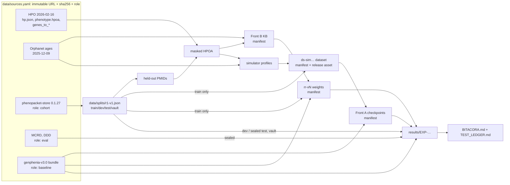

# Data lineage

Every number we report must trace back, with no gaps, to:
- pinned external bytes;
- a code SHA;
- a set of parameters.

This document says how that works and what we still cannot trace.

## 1. The graph

## 2. Rules

1. **Nothing enters without a pin.** Every external file is listed in
   `data/sources.yaml` with an immutable URL and its sha256. For a source
   whose upstream URL is mutable (Orphadata), we publish a snapshot as a
   release asset of this repo and pin that.
2. **Raw bytes are never edited.** `data/raw/` is populated only by
   `dxt sources fetch`, which verifies the sha256 whatever the origin (a local
   copy or the URL). GitHub release URLs are downloaded with `gh`, so private
   release assets (the Orphanet snapshot, the v3.0 bundle) work too. Code gets paths only through `registry.open_source(name,
   purpose)`, which also checks the role **[code]**.
3. **Roles limit flow [code].**
   - `knowledge` may feed anything.
   - `eval` may only be evaluated on.
   - `baseline` may be evaluated on or warm-started from, but never trained on
     as data.
   - `cohort` is reachable only through a frozen split, whose parts have their
     own purposes (`EVAL_PROTOCOL.md` §1).
4. **Every derived artifact has a manifest.** Datasets, KBs, embeddings,
   checkpoints and re-ranker weights each get
   `data/manifests/<artifact-id>.json`, recording:
   - the kind;
   - the creation time;
   - the code (repo, SHA, dirty flag);
   - the inputs (`id` + sha256: sources, splits, other artifacts, the
     held-out PMID list);
   - the params and their hash;
   - every output file with sha256 and size.

   `build_manifest` refuses a dirty working tree **[code]**.
5. **Artifact ids are immutable [code].** A changed artifact gets a new id
   (e.g. `ds-sim0.2.0-hpo20260216-n200-s42` → `…-s43`, or `sim0.2.1`).
   `write_manifest` refuses to overwrite.
6. **Storage.**
   - Manifests, splits, configs and results tables are committed to git.
   - Large binaries (datasets, checkpoints, KBs) are uploaded as **GitHub
     release assets** of this repo, one release per artifact id; the URL goes
     in the manifest notes (ADR-0005).
   - Local copies can be deleted and re-fetched; their hashes are re-checked.
7. **Cross-repo inputs are pinned by SHA.** Simulator output used here records
   the `rare-disease-simulator` commit and its config hash. Code copied from
   upstream or teammates carries a header naming the source repo, path and
   commit.
8. **Verify before logging.** Before an experiment is recorded, run
   `dxt lineage verify`. It re-hashes sources, re-checks split hashes, and
   re-hashes every manifest's outputs that are present locally.

## 3. Adding a source

1. Get an immutable URL: a release asset, a commit-pinned raw URL, or our own
   snapshot release.
2. Compute its sha256.
3. Choose its role, and justify it in the `notes` field.
4. Add the entry to `data/sources.yaml`, with `local_candidates` if a verified
   copy exists on this machine.
5. Run `dxt sources fetch <name>` and `dxt sources verify`.
6. Log it in `BITACORA.md`. If it is a patient source, it must get a frozen
   split before anyone looks at model outputs on it.

## 4. HPO versions in play

| Release | Where | Used for |
|---|---|---|
| 2026-02-16 | `hpo_*` sources | Annotations, KB, simulator profiles, graph ontology for new models |
| 2025-11-24 | inside the v3.0 bundle (`hp.json`) | v3.0's own graphs (parity) |
| 2025-03-17 | v3.0 embeddings (BioBERT-NLI memmap) | Node features; missing terms are zero vectors |
| 2025-11-24 | phenopacket-store 0.1.27 metadata | The cohort's annotations |
| 2026-01-08 | diagnostic.ar-api gateway `hp.obo` | Production extraction (outside this repo) |

Every evaluation reports the share of case terms that are unknown to the
model's ontology or zero-embedded.

## 5. Known gaps (declared, not fixable)

- **v3.0 training data is unavailable.** Here is what we know about it:
  - it was simulated from `genes_to_phenotype` (HPO ~2025-11);
  - it had 5,000 patients per gene, with `include_reverse_edges=False`;
  - it was built on the original author's machine.

  We cannot mask R1 publications out of it, so E0 on R1 is optimistic
  (`EVAL_PROTOCOL.md` §4.5).
- **The original sources of MCRD and DDD** are not documented in GraPhens;
  they must be cited in the informe once found. GraPhens also fine-tuned an
  experimental model on DDD (`validation_arena/finetune_ddd_model.py`). There
  is no evidence that v3.0 did.
- **DDD looks annotation-derived.** 97.1% of its cases carry an
  inheritance-mode term, and the median case's terms are all verbatim
  annotations of the gene (EXP-000 Addendum 1). It overstates real-patient
  performance of any model trained on HPO annotations.
- **R1 terms are often verbatim HPO annotations** (78% of dev cases are fully
  annotated, vs 3.5% for MCRD). This quantifies the E0-optimism caveat above.
- **Bitgenia cases** (`GraPhens/validation_arena/Casos_Bitgenia*.json`) are
  not registered. Their origin and consent status are unknown, so they are
  not used (G10).

## 6. Record of lineage events

| Date | Event | Details |
|---|---|---|
| 2026-09-28 | Sources registered | 9 sources; all verified from local copies (`dxt sources fetch --no-download`) |
| 2026-09-28 | Split `r1-v1` frozen | content sha256 `b007aa17741c2309a2fce9e36aaa77608d3d2b1311630e96c77be9d39e462ccf`, before any model was run on the cohort |
| 2026-09-29 | Source added | `graphens_sim_20251202` (S2, role eval) from GraPhens@7d861ff; MCRD and DDD marked `sealed` |
| 2026-09-29 | E0 measured (EXP-000) | Production parity: bit-identical to the vendored engine on 300 cases. Sealed reads of r1-v1/test, MCRD and DDD ledgered |
| 2026-09-28 | Leakage measured | 15,412 of 282,723 HPOA rows (5.45%, 457 diseases) cite R1 held-out PMIDs; MCRD/DDD have 0 exact (gene, present) overlaps with R1 |
